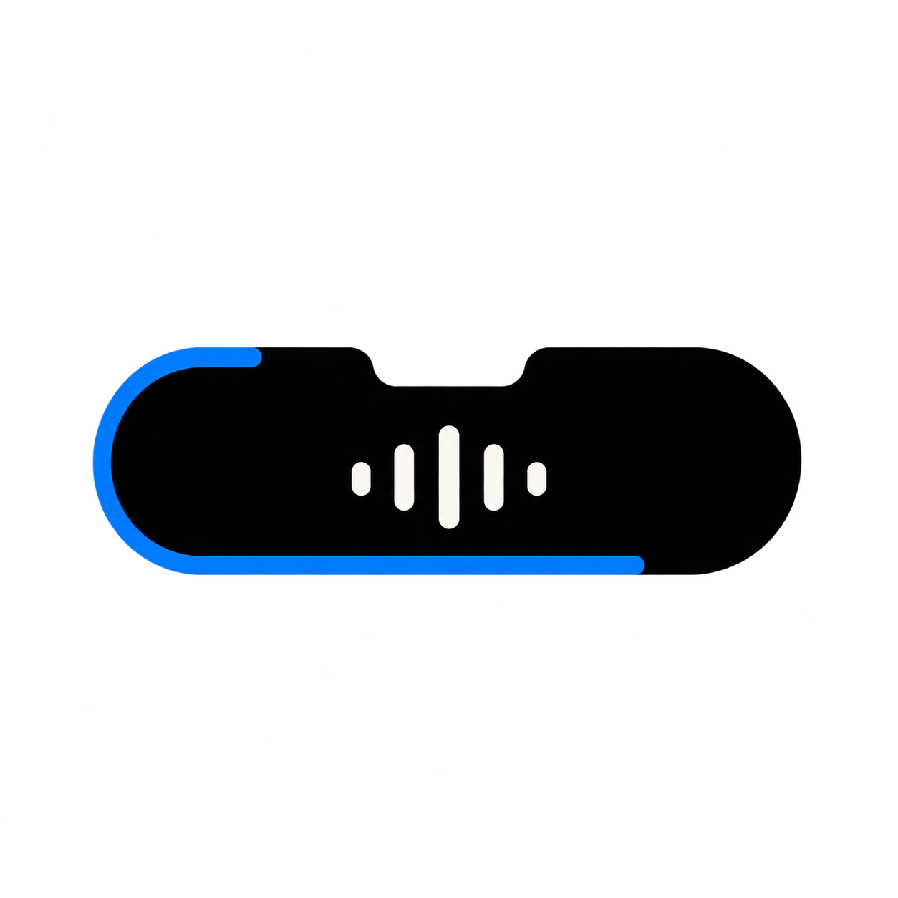
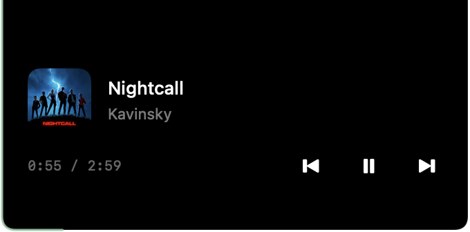

<div align="center">



# 🎵 Notch Musique

### Your notch had room. We gave it a job.


**“Tired of developers taking you for a ride? Codex helped me build this little gem in an hour.”** 🪿

*Easy, developers: we love you. My wallet is just a little sensitive.*

A discreet contour around your notch shows your Spotify track's progress.
Hover over it and the player unfolds. Your camera now has a music-loving neighbor.

**Free · Open source · No subscription · No Spotify developer account**

[👀 Take a look](#-take-a-look) · [🚀 Install](#-getting-started) · [🎨 Customize](#-make-yourself-at-home) · [🛠 Contribute](CONTRIBUTING.md)

</div>

---

<div align="center">

## 👀 Take a look

**At rest: just a line. We did say discreet.**


**On hover: the same contour stretches out.**



**In settings: your color, your thickness, your business.**


*Screenshots exported from the native application. Artwork and title depend on the current track. The current application interface is in French.*

</div>

## ✨ What's inside

| | A little luxury |
| :---: | :--- |
| 🎵 | Track progress around the notch. |
| 🖱️ | Hover to expand the contour and reveal playback information. |
| ⏯️ | Artwork, title, artist, time and Spotify controls. |
| 🎨 | Any color, with stroke thickness from 1 to 4 points. |
| 📐 | Dimensions follow your actual notch and stroke thickness. |
| 💾 | Settings survive a restart. |
| 🪶 | Event-based hover, fewer refreshes and no periodic progress redraws while paused. |
| 🫥 | No Dock window. A waveform icon in the menu bar. |

## 🚀 Getting started

You need **an Apple Silicon Mac with a notch**, **macOS 13 or later**, **Spotify desktop**, and **Apple's Command Line Tools** to compile. The build targets arm64; Intel support remains future work.

```sh
# If Apple's tools are not installed:
xcode-select --install

# From the project folder:
bash build.sh
open 'build/Notch Musique.app'
```

Play a track in Spotify, then hover over the line just below the notch. 🎶

macOS may ask for permission to control Spotify, used to read track information and send playback commands. If denied, open **System Settings → Privacy & Security → Automation**, then choose **Réessayer la connexion Spotify** (retry Spotify connection) from the waveform menu.

The build is locally signed without Apple notarization. Run `bash package-release.sh` to prepare a ZIP and checksum for a GitHub release; see [release packaging](docs/RELEASE.md). For local updates, quit the old instance before rebuilding and relaunching.

## 🎨 Make yourself at home

**Waveform icon → Apparence…** (Appearance)

Choose a color and thickness. Compact dimensions automatically follow **stroke thickness + 1 point of padding**. A thin line won't charge extra rent for screen space.

Changes apply immediately. Color and thickness are saved locally. The menu also lets you hide the contour or quit.

Enable **Waveform icon → Démarrer avec le système** (Launch at login) to start Notch Musique automatically when you sign in. Select it again to disable it. If macOS requires approval, the menu offers access to System Settings → General → Login Items. Keep the app in a stable location before enabling this option; if you move it, disable and enable it again from the new location. The option reflects macOS's actual status and is only checked when enabled.

To share the result, **Notch Musique menu → Exporter des captures…** (Export screenshots) saves three PNG views in your chosen folder without capturing other desktop windows.

## 🪶 What about resource use?

The first prototype was enthusiastic: mouse checks every 80 ms and ten progress redraws per second. Enthusiasm is nice. Battery life is nice too.

The release build uses hover events with a fallback check at most four times per second, compact progress drawing at most twice per second, and no periodic progress drawing while paused. Spotify notifications are backed by synchronization every 10 seconds during playback and 30 seconds while paused. Artwork is downsampled to **128 pixels maximum**. Periodic tasks stop when the contour is hidden or the display sleeps.

Local CPU observations dropped from roughly **3–4% to 0.4%** after settling. No RAM reduction has been demonstrated: around 33 MB before opening settings, with higher readings after exports. See [validation](docs/VALIDATION.md). These are observations on one machine, not a promise for every setup.

## 🔒 Permissions, without the spy novel

No microphone, audio recording, account signup or Spotify API key. The app communicates locally with Spotify through AppleScript and downloads artwork from the HTTPS URL supplied by the player. The project adds no listening history or analytics service.

## 🧪 Try it without music

Quit any existing instance, then run:

```sh
open 'build/Notch Musique.app' --args --demo
```

Demo mode shows a fictional track, clearly marked as simulated, without contacting Spotify. Quit it before relaunching normally.

For local checks:

```sh
bash build.sh
'build/Notch Musique.app/Contents/MacOS/NotchMusique' --self-test
```

## 🚧 The fine print

This is a young project built with Codex and tested on an Apple Silicon MacBook Air. Other hardware, fullscreen, display changes and sleep cycles need broader testing. Without a notched display, the contour stays hidden.

Spotify notifications do not guarantee future compatibility, so fallback polling remains. Seeking may take up to 10 seconds to synchronize during playback. AppleScript calls have a one-second timeout and run on the main thread; slow responses can still delay the UI. Playback controls are implemented but still need complete manual validation.

Independent project, unaffiliated with Apple or Spotify. See [development notes](docs/DEVELOPPEMENT.md) and [actual validation results](docs/VALIDATION.md).

<div align="center">

## 🤝 Got something better? We're listening.

Bug, idea or optimization? Contributions are welcome.

[🛠 Contributing guide](CONTRIBUTING.md) · [📜 MIT license](LICENSE) · [🎨 Logo and prompt](assets/LOGO.md)

**One useful notch. One less subscription to invent.** 🪿🎵

</div>
