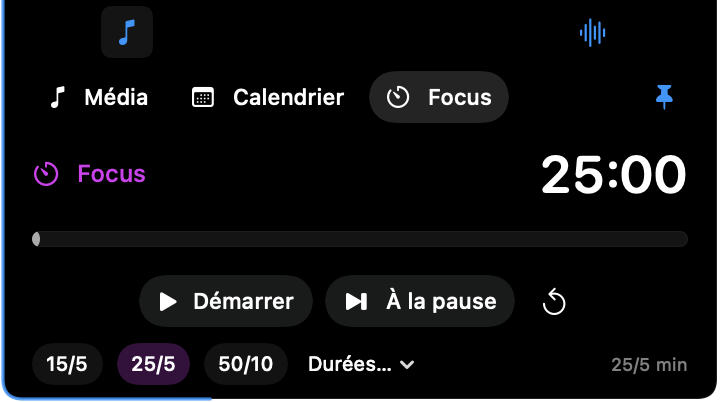
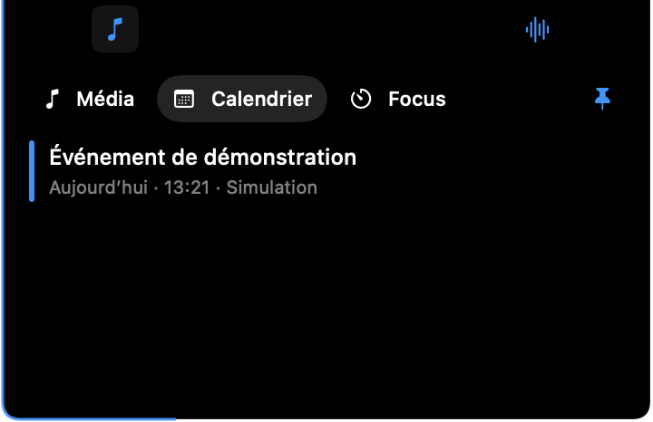
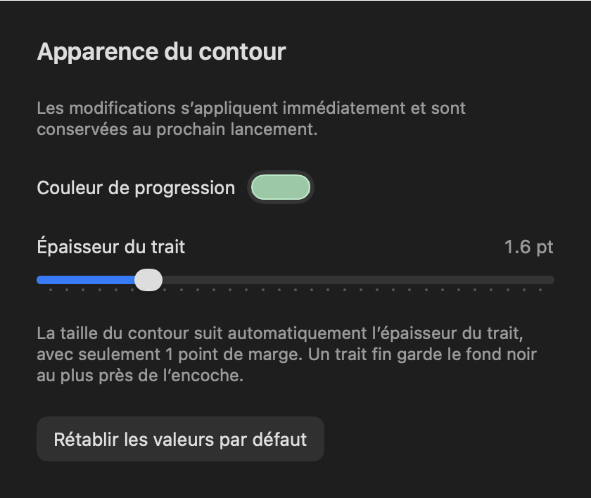

<div align="center">


# 🎵 Notch Musique

### Your notch had room. We gave it a job.


**“Tired of developers taking you for a ride? Codex helped me build this little gem in an hour.”** 🪿

*Easy, developers: we love you. My wallet is just a little sensitive.*

A compact glance around your notch shows Spotify artwork, an upcoming meeting, or your focus timer.
Hover to open a small panel with **Media · Calendar · Focus**. Your camera now has three useful neighbors.

**Free · Open source · No subscription · No Spotify developer account**

[👀 Take a look](#-take-a-look) · [🚀 Install](#-getting-started) · [🎨 Customize](#-make-yourself-at-home) · [🛠 Contribute](CONTRIBUTING.md)

</div>

---

<div align="center">

## 👀 Take a look

**At rest: artwork and playback status. Focus takes priority when a session is active.**


**On hover: the same contour stretches out.**


**Focus: 25 minutes of work, 5 minutes to breathe. Repeat.**



**Calendar: the next events, without a giant empty column.**



**In settings: your color, your thickness, your business.**



*Screenshots are native application renders. Music views show real Spotify playback; the focus and calendar examples use demo mode and the calendar event is fictional. The application interface is in French.*

</div>

## ✨ What's inside

| | A little luxury |
| :---: | :--- |
| 🎵 | Track progress around the notch. |
| 🖱️ | Hover to expand the contour and reveal playback information. |
| ⏯️ | Artwork, title, artist, time and Spotify controls. |
| 🎚️ | Seek through a track with the position slider. |
| 📅 | Upcoming events from calendars configured in macOS, with opt-in access. |
| ⏱️ | Automatic focus/break cycles, pause/resume, skip and saved duration choices. |
| 🎨 | Any color, with stroke thickness from 1 to 4 points. |
| 📐 | Dimensions follow your actual notch and stroke thickness. |
| 💾 | Settings survive a restart. |
| 🪶 | Event-based hover, fewer refreshes and no periodic progress redraws while paused. |
| 🫥 | No Dock window. A waveform icon in the menu bar. |

## 🚀 Getting started

You need **an Apple Silicon Mac with a notch**, **macOS 13 or later**, **Spotify desktop**, and **Apple's Command Line Tools** to compile. The build targets arm64; Intel support remains future work.

```sh
# If Apple's tools are not installed:
xcode-select --install

# From the project folder:
bash build.sh
open 'build/Notch Musique.app'
```

Play a track in Spotify, then hover over the notch or its activity wings. 🎶
Use **Waveform icon → Ouvrir le panneau…** (Open panel) to open and pin it directly. The pin button restores hover behavior when unselected.

macOS may ask for permission to control Spotify, used to read track information and send playback commands. If denied, open **System Settings → Privacy & Security → Automation**, then choose **Réessayer la connexion Spotify** (retry Spotify connection) from the waveform menu.

The build is locally signed without Apple notarization. Run `bash package-release.sh` to prepare a ZIP and checksum for a GitHub release; see [release packaging](docs/RELEASE.md). For local updates, quit the old instance before rebuilding and relaunching.

## 🎨 Make yourself at home

**Waveform icon → Apparence…** (Appearance)

Choose a color and thickness. The contour follows **stroke thickness + 1 point of padding**, with small wings beside the measured camera area for artwork and activity status. The open panel is normally 360 points wide, bounded by the actual screen edges.

Changes apply immediately. Color and thickness are saved locally. The menu also lets you hide the contour or quit.

Enable **Waveform icon → Démarrer avec le système** (Launch at login) to start Notch Musique automatically when you sign in. Select it again to disable it. If macOS requires approval, the menu offers access to System Settings → General → Login Items. Keep the app in a stable location before enabling this option; if you move it, disable and enable it again from the new location. The option reflects macOS's actual status and is only checked when enabled.

To share the result, **Notch Musique menu → Exporter des captures…** (Export screenshots) saves three PNG views in your chosen folder without capturing other desktop windows.

## ⏱️ Focus and calendar

Open **Focus → Démarrer** (Start) for the default **25-minute focus / 5-minute break** cycle. Phases advance automatically. Pause/resume, skip to the next phase, or reset the session. Choose **15/5**, **25/5**, **50/10**, or separate durations under **Durées…** while idle; reset an active session before changing them. Durations are saved. Quitting ends the session, while hiding the panel or sleeping the display lets time continue and catches up on return. A system beep announces a phase change while the app is visible. This timer does not enable macOS's system Focus mode or block other apps.

The closed notch shows the active focus's icon and remaining time, including when paused. Otherwise, an ongoing meeting or one starting within 15 minutes takes priority over music; without one, Spotify artwork and playback status remain visible.

Open **Calendrier → Connecter le calendrier** (Connect calendar) to request access. Notch Musique displays the next seven days of events from accounts configured in macOS Calendar, such as iCloud or Google. The app only reads events; macOS calls the required permission full calendar access on macOS 14+. It does not modify events, read reminders or store event titles on disk. Denying access leaves the music player and timer usable. Enable the Calendar account in macOS first; a Google or Outlook website alone is insufficient.

## ♥ Countdown to someone or something

When Spotify is paused or closed, the notch can show a personal countdown. Open the panel and select the **hourglass tab**. Enter a short label (up to 40 characters), such as “Summer holiday”, choose a future date and time, and select **Enregistrer** (Save). The editor stays pinned while you type; unpin it afterward to restore hover behavior.

The closed notch shows weeks/days and hours/minutes in its activity wings. Open Media while music is idle to see the label, full remaining time and target date. Active Focus and imminent meetings retain priority; Spotify playback brings back the music view. The label and deadline survive restarting the app. Use **Modifier…** (Edit) or the hourglass tab to change them, or **Supprimer** (Delete) to remove the countdown. At the deadline it shows “C’est le moment !” until edited or removed. There is no notification or alarm.

The target uses the local date and time selected when saving, then follows that absolute instant across sleep, restart and time-zone changes. Weeks and days mean elapsed durations of seven days and 24 hours; daylight-saving changes can therefore differ from calendar-day counts. Remaining minutes round up.

## 🪶 What about resource use?

The first prototype was enthusiastic: mouse checks every 80 ms and ten progress redraws per second. Enthusiasm is nice. Battery life is nice too.

The release build uses hover events with a fallback check at most four times per second and compact music progress drawing at most twice per second. An active focus updates once per second; calendar changes have a one-minute fallback. Spotify notifications are backed by synchronization every 10 seconds during playback and 30 seconds while paused. Artwork is downsampled to **128 pixels maximum**. Display timers stop when the contour is hidden or the display sleeps; focus deadlines continue logically.

Earlier music-only CPU observations dropped from roughly **3–4% to 0.4%** after settling. The new calendar and focus features have not been benchmarked. No RAM reduction has been demonstrated. See [validation](docs/VALIDATION.md).

## 🔒 Permissions, without the spy novel

No microphone, audio recording, account signup or Spotify API key. The app communicates locally with Spotify through AppleScript and downloads artwork from the HTTPS URL supplied by the player. The project adds no listening history or analytics service.

## 🧪 Try it without music

Quit any existing instance, then run:

```sh
open 'build/Notch Musique.app' --args --demo
```

Demo mode shows a fictional track, clearly marked as simulated, without contacting Spotify. Quit it before relaunching normally.

For local checks:

```sh
bash build.sh
'build/Notch Musique.app/Contents/MacOS/NotchMusique' --self-test
```

## 🚧 The fine print

This is a young project built with Codex and tested on an Apple Silicon MacBook Air. Other hardware, fullscreen, display changes and sleep cycles need broader testing. Without a notched display, the contour stays hidden.

Spotify notifications do not guarantee future compatibility, so fallback polling remains. Seeking may take up to 10 seconds to synchronize during playback. AppleScript calls have a one-second timeout and run on the main thread; slow responses can still delay the UI. Playback controls are implemented but still need complete manual validation.

Independent project, unaffiliated with Apple or Spotify. See [development notes](docs/DEVELOPPEMENT.md) and [actual validation results](docs/VALIDATION.md).

<div align="center">

## 🤝 Got something better? We're listening.

Bug, idea or optimization? Contributions are welcome.

[🛠 Contributing guide](CONTRIBUTING.md) · [📜 MIT license](LICENSE) · [🎨 Logo and prompt](assets/LOGO.md)

**One useful notch. One less subscription to invent.** 🪿🎵

</div>
